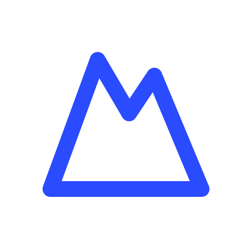

# Appeak Pro: App Store Optimization and AI visibility in your AI assistant



Appeak Pro is a free, remote MCP connector for App Store Optimization (ASO) and AI visibility. Add it to Claude, ChatGPT, Cursor, VS Code or any MCP client, then ask your assistant to audit an App Store or Google Play listing, check a title before you ship it, see where an app ranks, find who beats it in search, or check whether ChatGPT recommends it. It is built on 16+ years of ASO expertise.

- **Connector URL:** `https://appeak.pro/api/mcp`
- **Transport:** Streamable HTTP
- **Authentication:** none. No account, no API key.
- **Setup page:** https://appeak.pro/connect

This repository holds the connector's install configs, its registry metadata (`server.json`) and the Appeak Pro ASO skill. The connector itself is hosted by Appeak Pro.

## Tools

All tools are read-only.

| Tool | What it does |
| --- | --- |
| `audit_listing` | Audits a live App Store or Google Play listing. Each part (title, subtitle or short description, description, screenshots, ratings, localization) comes back as Working, Worth a look or Fix this, with the reason, the listing's facts and the biggest gaps. Rule-based, from the public listing. |
| `check_metadata` | Checks a draft title, App Store subtitle or Google Play short description, keyword field, description and promotional text against the store's rules: character limits, words repeated across fields, wasted keyword-field space, policy words. No store call. |
| `check_keyword_ranks` | Where an app ranks in the store's own search for up to 5 searches (top 50), with the apps on top. Without searches, it checks the phrases the title and subtitle are written for. |
| `find_competitors` | The apps that rank above this one in the searches its listing is written for, with the searches each one tops. |
| `search_aso_guide` | Finds articles in the Appeak Pro ASO Guide for an ASO question: keywords, screenshots, ratings, localization, Google Play tags, AI discoverability and more. |
| `check_ai_visibility` | Asks ChatGPT (with web search) the question people ask when looking for an app like this one, for example "What's the best budget planner app?", and says whether it names the app, at what position, and which apps it recommends instead. One question on one assistant (ChatGPT); answers are reused for a week and free use is capped. The free audit on appeak.pro runs the full AI visibility check across assistants. |

## Install

### Claude (web and desktop)

Settings, then Connectors, then Add custom connector. Name it `Appeak Pro` and paste `https://appeak.pro/api/mcp`. No sign-in needed.

### Claude Code

```bash
claude mcp add --transport http appeak-pro https://appeak.pro/api/mcp
```

Or install this repository as a plugin, which adds the connector and the ASO skill together:

```bash
/plugin marketplace add dondeking/appeak-pro-connector
/plugin install appeak-pro@appeak-pro
```

### ChatGPT

Settings, then Apps & Connectors, then Create (on plans that allow custom connectors). Paste `https://appeak.pro/api/mcp` with no authentication.

### Cursor

Add to `~/.cursor/mcp.json`:

```json
{
  "mcpServers": {
    "appeak-pro": {
      "url": "https://appeak.pro/api/mcp"
    }
  }
}
```

### VS Code

Add to `.vscode/mcp.json`:

```json
{
  "servers": {
    "appeak-pro": {
      "type": "http",
      "url": "https://appeak.pro/api/mcp"
    }
  }
}
```

### Windsurf, Cline and other MCP clients

Add a remote (HTTP) server with the URL `https://appeak.pro/api/mcp`. Clients that only run local servers can use the `mcp-remote` bridge:

```json
{
  "mcpServers": {
    "appeak-pro": {
      "command": "npx",
      "args": ["-y", "mcp-remote", "https://appeak.pro/api/mcp"]
    }
  }
}
```

## Example prompts

- "Audit this listing: https://apps.apple.com/us/app/id570060128"
- "Write an App Store title, subtitle and keyword field for my budgeting app, and check them against the store rules."
- "Where does my app rank for budget planner and expense tracker?"
- "Who are my app's search competitors on Google Play?"
- "How should I pick Google Play tags?"
- "Does ChatGPT recommend my app? https://apps.apple.com/us/app/id570060128"

## The Appeak Pro ASO skill

`skills/appeak-aso/SKILL.md` tells Claude and other skill-aware agents when to use each tool and the store rules to follow. It is also at https://appeak.pro/integrations/appeak-aso/SKILL.md.

## What the plugin runs, sends and fetches

The plugin contains no code. It adds one remote MCP server, `https://appeak.pro/api/mcp`, and one skill made of plain instructions. When you call a tool, your assistant sends the tool's inputs (a store link, a country code, draft listing copy, searches or an ASO question) to that server. The server reads public App Store and Google Play data and the Appeak Pro ASO Guide. For `check_ai_visibility`, it also asks ChatGPT (OpenAI, with web search) one question about the app's category; answers are cached for a week. Results are text and may include links to appeak.pro.

## Privacy and data

The connector reads public store data only and needs no account. It does not store what you send it, except that ChatGPT visibility answers are cached per app and market for a week. Free use is capped so the stores keep answering, and ChatGPT checks have a daily cap.

- Privacy policy: https://appeak.pro/privacy
- Terms: https://appeak.pro/terms

## Support

Appeak Pro LLC, 14205 N Mo Pac Expy, Ste 570, Austin, TX 78728, United States.
Email: appeakpro@gmail.com. Website: https://appeak.pro
